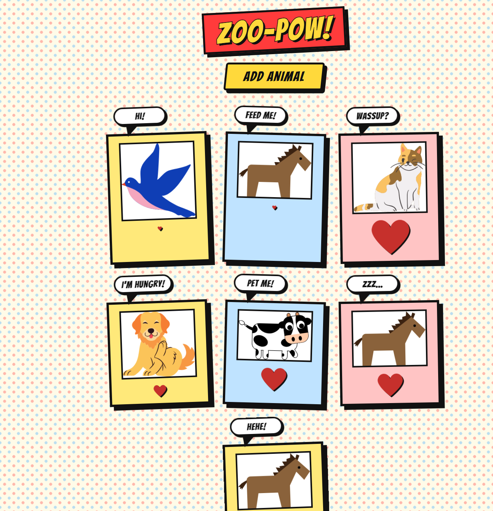

# 🐾 Clicky Pets

A small, playful React app where you adopt random animals and shower them with love. Click the button to add a pet, then click the pet to make its heart grow bigger and bigger. Styled in a cartoon comic-book look, complete with thick outlines and speech bubbles.



## Features

- **Add animals:** every click on "Add Animal" adds a random pet (bird, cat, cow, dog, gator or horse).
- **Show some love:** click any animal and its heart grows a little more each time.
- **Comic style:** halftone background, bold outlines, hard shadows, and CSS-only speech bubbles that change as you click ("Hi!", "Feed me!", "POW!!").

## Built with

- [React](https://react.dev/) with hooks (`useState`)
- Plain CSS (no UI libraries)
- SVG animal illustrations

## Getting started

### Prerequisites

- [Node.js](https://nodejs.org/) (v18 or newer recommended)
- npm

### Installation

```bash
# clone the repository
git clone https://github.com/majd-hourani/clicky-pets.git

# go into the project folder
cd clicky-pets

# install dependencies
npm install

# start the development server
npm start
```

Then open the local address shown in your terminal (usually `http://localhost:3000`).

## Project structure

```
clicky-pets/
├── image.png          # screenshot used in this README
└── src/
    ├── App.js         # main component: the button and the list of animals
    ├── AnimalShow.js  # a single animal card with its growing heart
    ├── App.css        # all the comic-style styling
    └── svg/           # animal and heart illustrations
```

## How it works

- `App` keeps an array of animals in state. Each click on the button appends a random animal name to it.
- `AnimalShow` receives an animal name, looks up its SVG, and keeps its own `clicks` counter in state. Every click on the card makes the heart image bigger.
- Styling lives in `App.css`. The speech bubbles use `::before` and `::after` pseudo-elements, so they need no extra markup.

## Author

Made by [Majd Hourani](https://github.com/majd-hourani).
